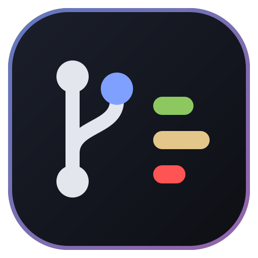
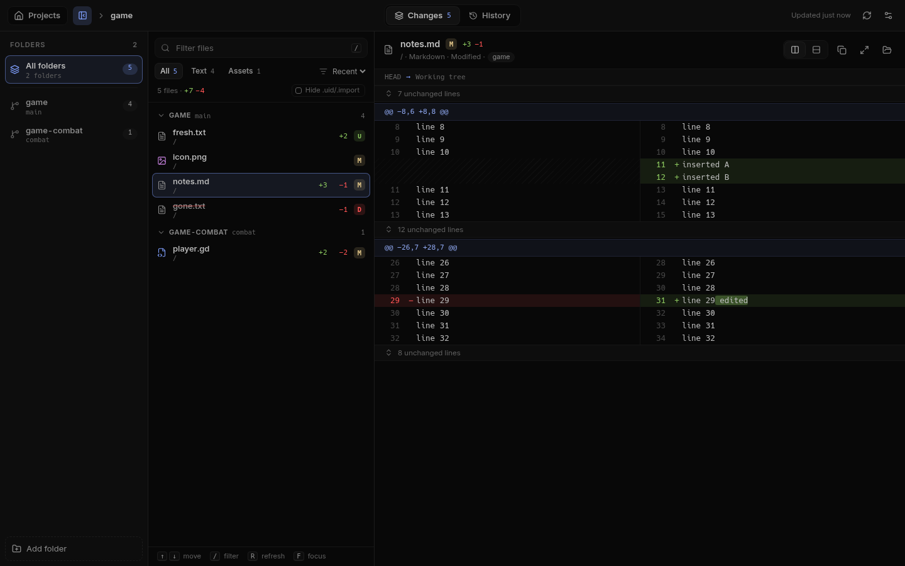
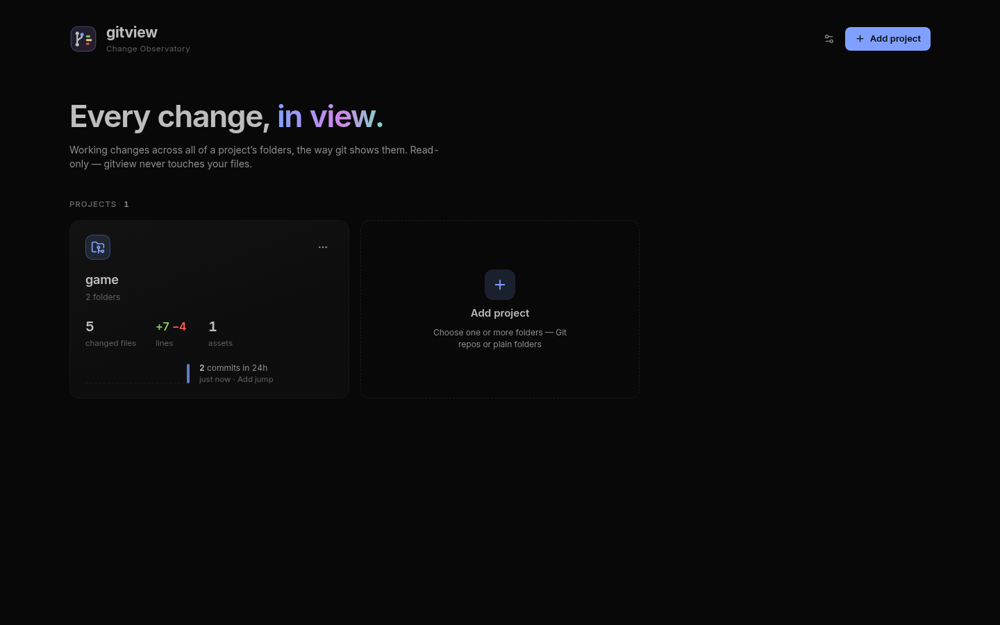
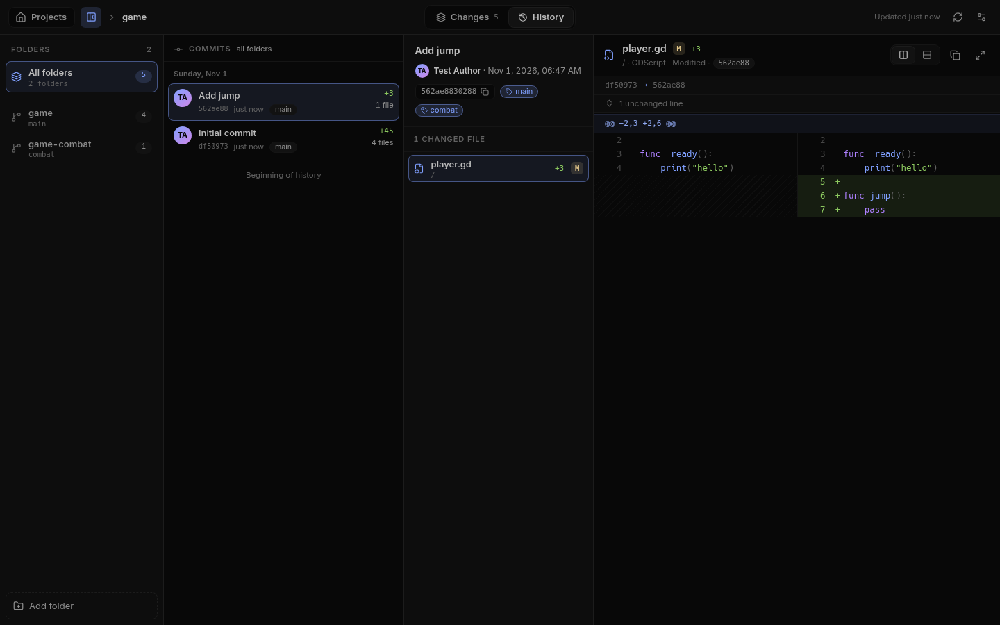

<p align="center">
  
</p>

<h1 align="center">gitview</h1>

<p align="center">
  A calm, read-only desktop viewer for every working change across a project's folders — the way git shows them.
</p>

<p align="center">
  
</p>

## What it does

- **Projects made of folders.** Add one or more folders as a project — Git repositories, worktrees of the same repository, or plain folders. Each project gets a card with its changed files, lines added and removed, assets, and commit activity over the last 24 hours.
- **Git-style changes.** Every changed file with its status (`M` `A` `D` `R` `U`), grouped by folder, with search, Text/Assets filters and sorting. Staged and unstaged changes can be viewed together or separately.
- **Real diffs.** Side-by-side or unified, syntax-highlighted, with word-level highlights and collapsible unchanged regions.
- **Assets stay simple.** Images, models, audio, fonts, archives and other binary or complex files show only their type and size — never a wall of noise.
- **Files.** Browse every file in a project's folders as a tree, not just the changed ones: text with line numbers and highlighting, images, audio and video previewed in place, changed files marked with their status.
- **History.** Commits from every folder in one timeline; open a commit to see its files and their diffs.
- **Plain folders too.** Folders without Git are compared against a snapshot taken the first time you open them (resettable).
- **Read-only.** gitview never writes to the folders it shows. Git is queried with `--no-optional-locks`.
- **Fits any window.** No minimum window size, so tiled windows lay out at their real size. The folder sidebar collapses, the file list is resizable, focus mode gives a file the whole window, and narrow windows stack list and file.
- **Omarchy aware.** On [Omarchy](https://omarchy.org), colours and code highlighting follow the active theme and update live when it changes. Elsewhere it uses its own dark palette.

<p align="center">
  
  
</p>

## Install

Download the latest release from the [Releases page](https://github.com/boraned/gitview/releases):

- `gitview-<version>-x86_64.AppImage` — make it executable and run it:
  ```sh
  chmod +x gitview-*-x86_64.AppImage
  ./gitview-*-x86_64.AppImage
  ```
- `gitview-<version>-x64.tar.gz` — extract and run `./gitview`.

Requires `git` on your `PATH`.

## Keyboard

| Key | Action |
| --- | --- |
| `↑` `↓` / `j` `k` | Move through files or commits |
| `/` | Filter or find files |
| `F` | Focus the open file (narrow windows: open it) |
| `Esc` | Back / leave focus |
| `[` | Show or hide the folder sidebar |
| `1` `2` `3` | Changes / History / Files |
| `R` | Refresh |
| `Alt+←` | Back to projects |

## Build from source

```sh
git clone https://github.com/boraned/gitview.git
cd gitview
npm install
npm start          # build the renderer and launch
npm run dist       # AppImage + tar.gz in release/
```

Tests:

```sh
npm test                                   # backend tests on a generated fixture repository
PLAYWRIGHT_DIR=/path/to/playwright npm run test:e2e   # drives the real app under xvfb
```

## How it works

The Electron main process (`electron/`) is plain CommonJS: `backend.cjs` reads `git status --porcelain=v2`, numstat and object contents; `history.cjs` merges commit logs across worktrees; `store.cjs` keeps projects and settings in the app's config folder. The renderer (`src/`) is React + TypeScript built with Vite, with diffs from [`diff`](https://github.com/kpdecker/jsdiff) and highlighting from [Shiki](https://shiki.style).

## License

[MIT](LICENSE)
